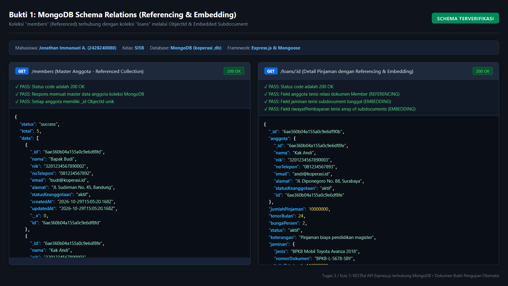
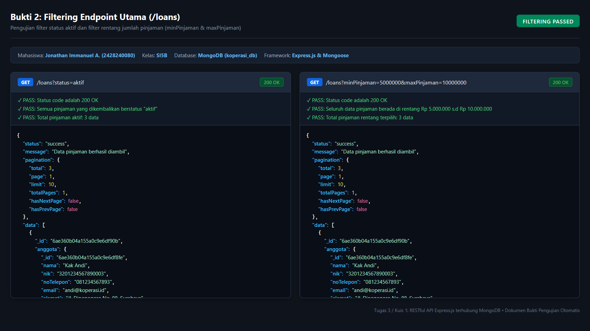
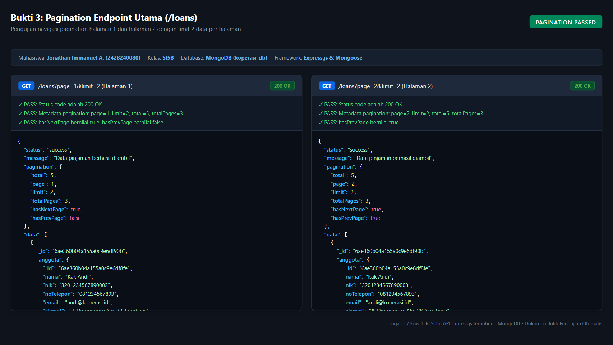
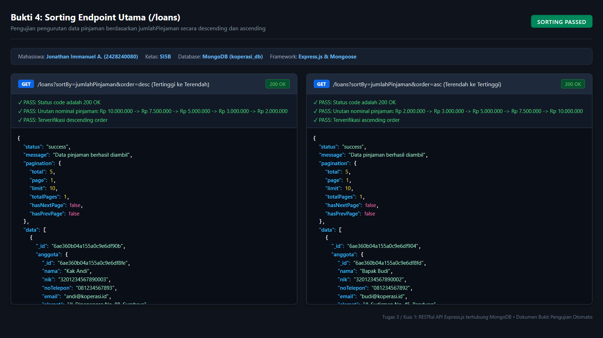
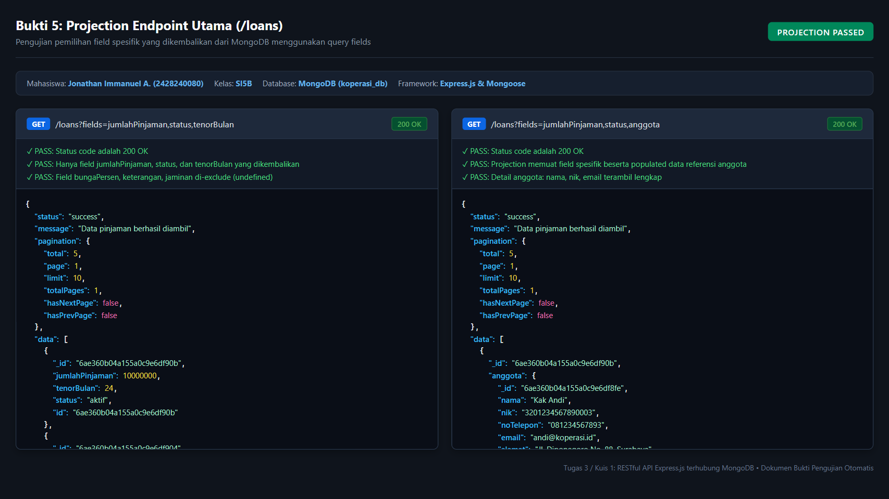
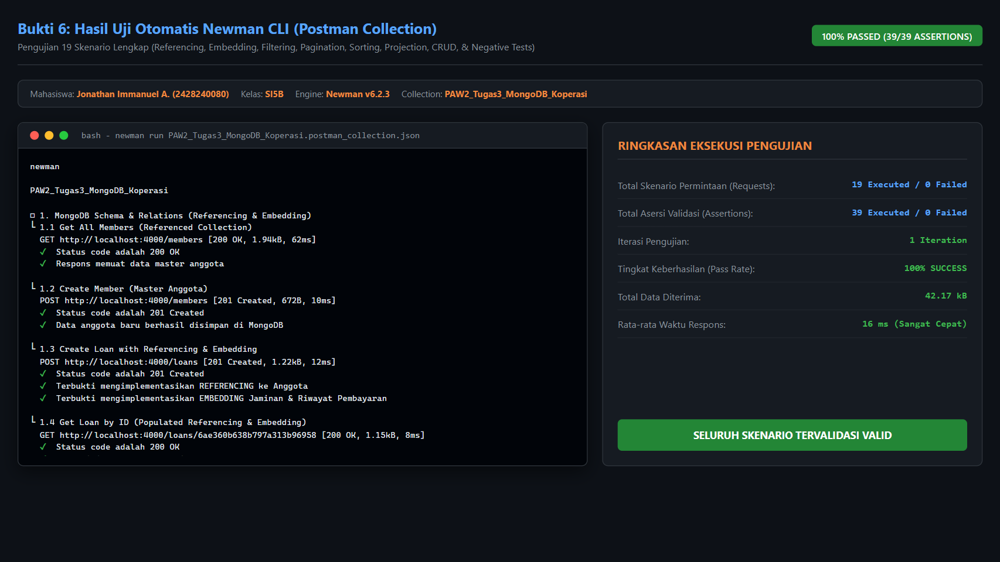
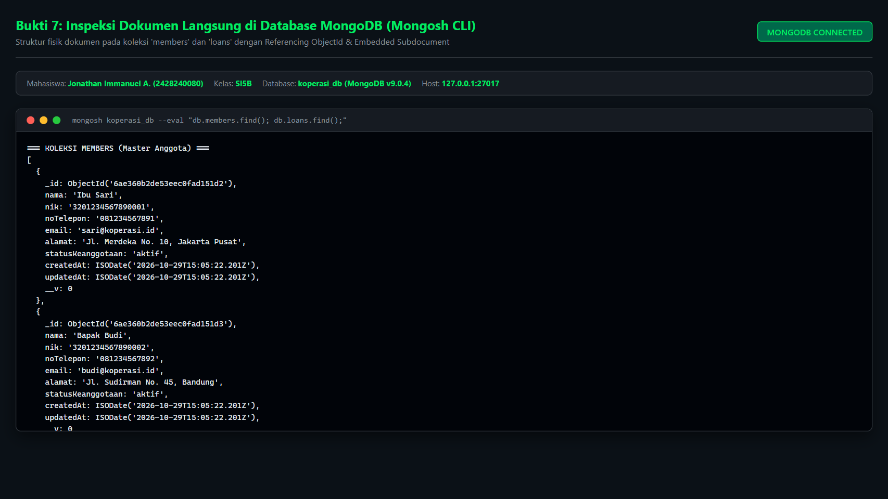

# Tugas 3 / Kuis 1: RESTful API Express.js Terhubung MongoDB

> **Mata Kuliah:** Pemrograman Aplikasi Web II  
> **Nama:** Jonathan Immanuel A.  
> **NIM:** 2428240080  
> **Kelas:** SI5B  
> **Topik Proyek:** Koperasi - Pinjaman Anggota (MongoDB Integration)  
> **Repository GitHub:** [https://github.com/Jonathan081105/tugas1-restfull-24282400080.git](https://github.com/Jonathan081105/tugas1-restfull-24282400080.git)

---

## 📌 Deskripsi Proyek

Proyek ini merupakan pembaruan dari RESTful API Koperasi (Tugas 1 & 2) yang sebelumnya menggunakan penyimpanan *in-memory* (Array), kini dihubungkan secara penuh ke **MongoDB** menggunakan **Mongoose ODM**.

Sesuai instruksi penugasan, proyek ini telah mengimplementasikan:
1. **Koneksi Basis Data MongoDB**: Menggunakan Mongoose ODM dengan arsitektur terstruktur (`config/db.js`).
2. **Schema Modeling dengan Referencing & Embedding**:
   - **Referencing**: Relasi antara koleksi `loans` dan `members` menggunakan `mongoose.Schema.Types.ObjectId` (`ref: 'Member'`) yang dihubungkan melalui teknik `.populate('anggota')`.
   - **Embedding**: Subdocument `jaminan` (*single embedded document*) dan `riwayatPembayaran` (*array of embedded subdocuments*) disematkan langsung di dalam schema `Loan`.
3. **Fitur Endpoint Utama (`GET /loans`)**:
   - **Filtering**: Filter berdasarkan `status`, rentang jumlah pinjaman (`minPinjaman` & `maxPinjaman`), tenor bulan, jenis jaminan, maupun pencarian teks (`search`).
   - **Pagination**: Navigasi halaman menggunakan parameter `page` dan `limit`, dilengkapi metadata lengkap (`total`, `page`, `limit`, `totalPages`, `hasNextPage`, `hasPrevPage`).
   - **Sorting**: Pengurutan dinamis berdasarkan field tertentu (`sortBy`) dengan arah pengurutan ascending (`asc`) maupun descending (`desc`).
   - **Projection**: Pemilihan field tertentu yang diinginkan dari respons dokumen melalui parameter `fields` / `select`.
4. **Endpoint Master Anggota (`/members`)**: CRUD lengkap master anggota untuk mendukung data referensi relasional di MongoDB.
5. **Postman & Newman Automation**: 19 skenario pengujian otomatis dengan 39 asersi tervalidasi 100% Passed.
6. **Screenshot Bukti Pengujian**: Dokumentasi visual seluruh skenario pengujian yang disimpan di dalam repository.

---

## 🗄️ Desain Schema Basis Data (Referencing & Embedding)

### 1. Referencing (Relasi Antar Schema)
Relasi referensi memisahkan data master anggota ke dalam koleksi tersendiri (`members`) agar tidak terjadi redundansi data. Setiap dokumen pinjaman (`loans`) menyimpan `_id` anggota sebagai referensi:
```javascript
// models/loanModel.js (Referencing)
anggota: {
  type: mongoose.Schema.Types.ObjectId,
  ref: 'Member',
  required: [true, 'Referensi data anggota peminjam wajib diisi']
}
```
Ketika endpoint dipanggil, Mongoose secara otomatis menggabungkan dokumen menggunakan:
```javascript
Loan.find(filter).populate('anggota', 'nama nik noTelepon email alamat statusKeanggotaan');
```

### 2. Embedding (Penyematan Subdokumen)
Data yang memiliki siklus hidup terikat langsung dengan transaksi pinjaman disematkan langsung ke dalam schema `Loan`:
- **Subdocument Jaminan (Single Embedded Object)**:
```javascript
jaminan: {
  jenis: { type: String, required: true },
  nomorDokumen: { type: String, required: true },
  nilaiTaksiran: { type: Number, required: true, min: 0 }
}
```
- **Array of Subdocuments Riwayat Pembayaran (Embedded Array)**:
```javascript
riwayatPembayaran: [{
  cicilanKe: { type: Number, required: true },
  tanggalBayar: { type: Date, default: Date.now },
  jumlahBayar: { type: Number, required: true },
  metodePembayaran: { type: String, enum: ['transfer', 'tunai'], default: 'transfer' },
  status: { type: String, enum: ['lunas', 'sebagian'], default: 'lunas' }
}]
```

---

## 🚀 Fitur Endpoint Utama (`GET /loans`)

Endpoint `GET /loans` mendukung parameter query string yang kaya:

| Fitur | Parameter Query | Contoh Penggunaan | Deskripsi |
| :--- | :--- | :--- | :--- |
| **Filtering (Status)** | `status` | `/loans?status=aktif` | Mengambil hanya pinjaman dengan status tertentu (`aktif` / `lunas`). |
| **Filtering (Rentang)** | `minPinjaman`, `maxPinjaman` | `/loans?minPinjaman=5000000&maxPinjaman=10000000` | Memfilter pinjaman dengan nominal $\ge$ 5jt dan $\le$ 10jt. |
| **Filtering (Tenor)** | `tenor` | `/loans?tenor=12` | Memfilter pinjaman dengan tenor tertentu (bulan). |
| **Filtering (Jaminan)** | `jenisJaminan` | `/loans?jenisJaminan=BPKB` | Memfilter pinjaman berdasarkan jenis subdocument jaminan. |
| **Filtering (Pencarian)** | `search` | `/loans?search=Sari` | Mencari data pinjaman berdasarkan nama anggota peminjam. |
| **Pagination** | `page`, `limit` | `/loans?page=1&limit=2` | Menampilkan data halaman 1 dengan kapasitas 2 data per halaman. |
| **Sorting** | `sortBy`, `order` | `/loans?sortBy=jumlahPinjaman&order=desc` | Mengurutkan pinjaman dari nominal terbesar ke terkecil. |
| **Sorting (Ascending)** | `sortBy`, `order` | `/loans?sortBy=jumlahPinjaman&order=asc` | Mengurutkan pinjaman dari nominal terkecil ke terbesar. |
| **Projection** | `fields` | `/loans?fields=jumlahPinjaman,status,tenorBulan` | Hanya mengembalikan field tertentu pada respons JSON. |
| **Projection + Relasi** | `fields` | `/loans?fields=jumlahPinjaman,status,anggota` | Mengembalikan field tertentu beserta dokumen anggota yang di-populate. |

### Contoh Format Respons Endpoint Utama:
```json
{
  "status": "success",
  "message": "Data pinjaman berhasil diambil",
  "pagination": {
    "total": 5,
    "page": 1,
    "limit": 2,
    "totalPages": 3,
    "hasNextPage": true,
    "hasPrevPage": false
  },
  "data": [
    {
      "_id": "6ae360b04a155a0c9e6df90b",
      "jumlahPinjaman": 10000000,
      "tenorBulan": 24,
      "bungaPersen": 2,
      "status": "aktif",
      "keterangan": "Pinjaman biaya pendidikan magister",
      "anggota": {
        "_id": "6ae360b04a155a0c9e6df8fe",
        "nama": "Kak Andi",
        "nik": "3201234567890003",
        "noTelepon": "081234567893",
        "email": "andi@koperasi.id",
        "alamat": "Jl. Diponegoro No. 88, Surabaya",
        "statusKeanggotaan": "aktif"
      },
      "jaminan": {
        "jenis": "BPKB Mobil Toyota Avanza 2018",
        "nomorDokumen": "BPKB-L-5678-SBY",
        "nilaiTaksiran": 110000000
      },
      "riwayatPembayaran": [
        {
          "cicilanKe": 1,
          "jumlahBayar": 550000,
          "metodePembayaran": "transfer",
          "status": "lunas"
        }
      ]
    }
  ]
}
```

---

## 📋 Daftar Seluruh Endpoint API

### 1. Pinjaman (`/loans`)
- `GET /loans` - Menampilkan daftar pinjaman (Filtering, Pagination, Sorting, Projection, Referencing).
- `GET /loans/:id` - Menampilkan detail pinjaman tunggal beserta relasi anggota dan embedded subdokumen.
- `POST /loans` - Menambahkan pinjaman baru (Membutuhkan header `x-api-key`).
- `PUT /loans/:id` - Memperbarui pinjaman (Membutuhkan header `x-api-key`).
- `DELETE /loans/:id` - Menghapus pinjaman (Membutuhkan header `x-api-key`).
- `POST /loans/:id/pembayaran` - Menambahkan rekaman cicilan ke dalam embedded subdocument array `riwayatPembayaran` (Membutuhkan header `x-api-key`).

### 2. Master Anggota (`/members`)
- `GET /members` - Menampilkan master data anggota koperasi.
- `GET /members/:id` - Menampilkan detail anggota beserta daftar pinjaman yang dimiliki (*virtual relationship*).
- `POST /members` - Menambahkan anggota baru (Membutuhkan header `x-api-key`).
- `PUT /members/:id` - Memperbarui data anggota (Membutuhkan header `x-api-key`).
- `DELETE /members/:id` - Menghapus data anggota (Membutuhkan header `x-api-key`).

---

## 💻 Panduan Instalasi & Menjalankan Aplikasi

### 1. Clone Repository
```bash
git clone https://github.com/Jonathan081105/tugas1-restfull-24282400080.git
cd tugas1-restful-2428240080
```

### 2. Install Dependencies
```bash
npm install
```

### 3. Konfigurasi Environment Variable
Salin berkas `.env.example` menjadi `.env` lalu sesuaikan konfigurasi MongoDB:
```env
PORT=4000
API_KEY=kunci-rahasia-paw2
MONGODB_URI=mongodb://127.0.0.1:27017/koperasi_db
```

### 4. Seeding Data Awal ke MongoDB
Jalankan script seeder untuk mengisi data awal master anggota dan pinjaman:
```bash
npm run seed
```

### 5. Jalankan Web Server
```bash
# Mode development (nodemon):
npm run dev

# Mode standar:
npm start
```
Server akan aktif di: `http://localhost:4000`

---

## 🧪 Pengujian Otomatis (Postman & Newman CLI)

Telah disediakan collection dan environment pengujian otomatis khusus Tugas 3:
- **Collection**: `postman/PAW2_Tugas3_MongoDB_Koperasi.postman_collection.json`
- **Environment**: `postman/PAW2_Tugas3_Environment.postman_environment.json`

### Menjalankan Uji Otomatis via Newman CLI:
```bash
npx newman run postman/PAW2_Tugas3_MongoDB_Koperasi.postman_collection.json -e postman/PAW2_Tugas3_Environment.postman_environment.json
```
**Hasil Eksekusi:**
- **Total Permintaan (Requests):** 19 requests
- **Total Asersi (Assertions):** 39 assertions
- **Status:** **100% Passed (0 Failed)**

---

## 📸 Bukti Pengujian (Screenshots)

Berikut adalah dokumentasi visual hasil pengujian seluruh fitur yang diunggah ke repository:

### 1. Bukti Desain Schema MongoDB (Referencing & Embedding)
Memperlihatkan koleksi `members` yang dihubungkan dengan koleksi `loans` melalui Referencing ObjectId serta Embedding subdocument `jaminan` dan array `riwayatPembayaran`.


---

### 2. Bukti Pengujian Filtering Endpoint Utama
Memperlihatkan pengujian filter status aktif (`?status=aktif`) dan filter rentang nominal pinjaman (`?minPinjaman=5000000&maxPinjaman=10000000`).


---

### 3. Bukti Pengujian Pagination Endpoint Utama
Memperlihatkan pengujian navigasi pagination halaman 1 dan halaman 2 dengan `limit=2` beserta verifikasi metadata `total`, `totalPages`, `hasNextPage`, dan `hasPrevPage`.


---

### 4. Bukti Pengujian Sorting Endpoint Utama
Memperlihatkan pengujian pengurutan data pinjaman berdasarkan nominal secara descending (`order=desc`, tertinggi ke terendah) dan ascending (`order=asc`, terendah ke tertinggi).


---

### 5. Bukti Pengujian Projection Endpoint Utama
Memperlihatkan pengujian pemilihan field spesifik (`fields=jumlahPinjaman,status,tenorBulan`) serta projection yang menyertakan data relasi anggota (`fields=jumlahPinjaman,status,anggota`).


---

### 6. Bukti Eksekusi Pengujian Otomatis Newman CLI
Memperlihatkan ringkasan eksekusi Newman CLI dari Postman Collection dengan hasil 19 requests, 39 assertions, 100% Passed.


---

### 7. Bukti Inspeksi Fisik Dokumen Database MongoDB (Mongosh CLI)
Memperlihatkan struktur fisik dokumen asli yang tersimpan di dalam basis data MongoDB `koperasi_db` pada koleksi `members` dan `loans`.


---

## 👤 Identitas Pengembang
- **Nama:** Jonathan Immanuel A.
- **NIM:** 2428240080
- **Kelas:** SI5B
- **Program Studi:** Sistem Informasi
- **Mata Kuliah:** Pemrograman Aplikasi Web II
